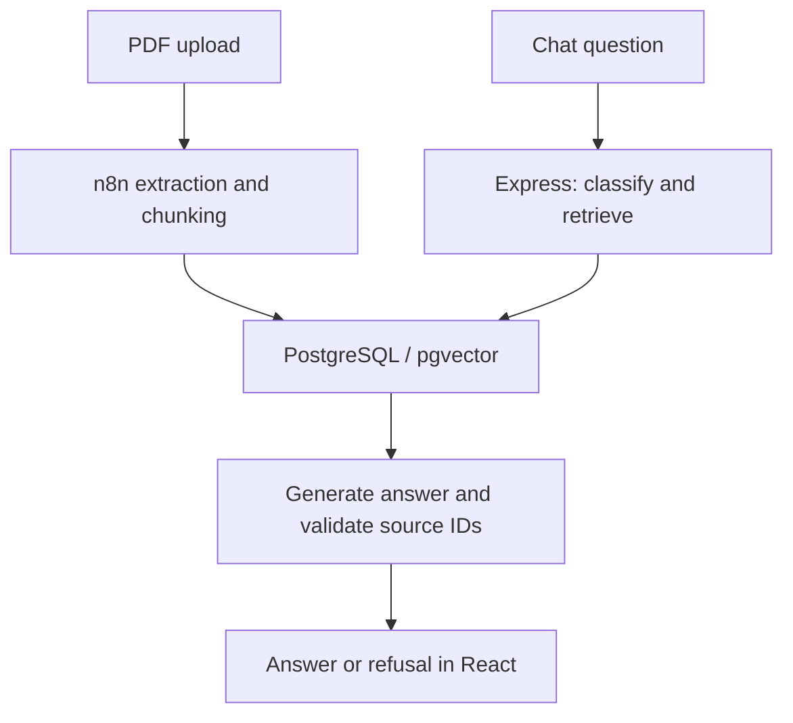

# DocTrace

**Ask questions about accounting PDFs and inspect the document sources returned with each answer.**

A portfolio prototype built with React, TypeScript, Express, PostgreSQL/pgvector, n8n and OpenAI. It connects PDF ingestion to hybrid retrieval and validates cited chunk IDs before returning an answer. It is designed to make the retrieval path and its limitations inspectable.

[Demo setup](#run-a-local-demo) · [Architecture](#how-it-works) · [Code walkthrough](#code-walkthrough) · [Verification](#verification) · [Portuguese operating guide](README.pt-BR.md)

> **Status:** local demonstration prototype. Backend tests and frontend build/lint pass. Docker ingestion and real model calls were not executed during this review. No public live demo or production deployment is claimed.

## Product walkthrough

1. Upload a text-based accounting PDF.
2. Ask a complete question about a fact in that document.
3. Inspect the answer and source document names.
4. Ask for a missing fact: the expected behavior is an explicit refusal without sources.

The sample [fictional company report](docs/samples/relatorio-demo.html) supplies known facts for evaluation. Print it to PDF and use a fresh local demo database. A successful upload notification alone is insufficient: verify chunks were stored before evaluating answers.

## How it works



- n8n splits extracted text into 1,200-character chunks with 200-character overlap and generates 1,536-dimensional embeddings.
- The backend classifies intent, then creates a lexical, semantic or hybrid search plan. Accounting questions require retrieved evidence, including general accounting questions.
- Retrieval returns up to eight chunks. Each must satisfy `MIN_SIMILARITY` before generation; lexical matches do not receive artificial similarity scores.
- Structured answers must cite known context IDs. Unknown IDs, malformed responses and missing evidence produce a fallback refusal.
- `confidence` describes intent classification, **not answer accuracy**. Valid source IDs do not prove that a source supports every generated claim.

The UI keeps messages only until reload and sends only the current question. The ingestion workflow does not preserve page numbers (`page_number` is null), and the UI does not download original PDFs.

## Code walkthrough

| Concern | Entry point | What to inspect |
| --- | --- | --- |
| HTTP contract | [Chat controller](backend/src/controllers/chat.controller.ts) | Rejects blank, non-string and overlong input before model calls |
| Retrieval | [Vector service](backend/src/services/vector.service.ts) | Parameterized lexical terms and vector distance ranking |
| Source validation | [Answer service](backend/src/services/document-answer.service.ts) | Similarity filtering, unknown-ID rejection and deduplication |
| Ingestion | [n8n workflow](n8n/doctrace-ingestao.json) | PDF extraction, overlap and database writes |
| Data model | [Initialization SQL](infra/postgres/init.sql) | Documents, chunks, vector extension and uniqueness constraints |
| Same-origin demo | [Compose](docker-compose.demo.yml) and [gateway](infra/demo/nginx.conf) | Compiled frontend and API/webhook routing |
| Regression tests | [Backend tests](backend/tests) | Provider/database mocks and executable workflow snippets |

## Run a local demo

Use Docker Engine/Desktop with Compose v2, Git, and credentials for the provider models configured in source. Runtime model access and costs depend on your account; this review did not make paid API calls.

```bash
git clone https://github.com/joaovitormessias/doctrace.git
cd doctrace
cp .env.example .env
```

Edit `.env`: choose a database password, use that same password in `DATABASE_URL`, and configure `OPENAI_API_KEY`. Keep `.env` private. The backend and n8n each need their own provider credential configuration.

```bash
docker compose -p doctrace-demo -f docker-compose.demo.yml config --quiet
docker compose -p doctrace-demo -f docker-compose.demo.yml up -d --build
docker compose -p doctrace-demo -f docker-compose.demo.yml ps
```

Open the app at **http://localhost:8088** and the local n8n editor at **http://localhost:5679**.

1. Create the n8n owner account and import `n8n/doctrace-ingestao.json`.
2. Configure the OpenAI Bearer credential and PostgreSQL credential (host `postgres`, port `5432`, values from `.env`).
3. Publish/activate the workflow. The app calls `/webhook/ingest-document`, not the test webhook.
4. Print the fictional report to PDF, upload it, and inspect the n8n execution and database rows.
5. Ask for the company name and January 2026 net income; compare against the sample. Then ask for its absent CNPJ and verify refusal.

The [detailed operating guide](README.pt-BR.md) includes credential fields, SQL verification, acceptance cases and troubleshooting. [Link sharing](docs/ACESSO-POR-LINK.md) is documented separately; it does not mean a demo is currently hosted.

To stop while retaining database volumes:

```bash
docker compose -p doctrace-demo -f docker-compose.demo.yml down
```

`init.sql` runs only on new volumes. Existing databases require schema review/migration; do not delete existing data to apply initialization SQL.

## API example

After ingestion, this request consumes provider API calls:

```bash
curl http://localhost:8088/api/chat \
  -H 'Content-Type: application/json' \
  -d '{"question":"Segundo relatorio-demo.pdf, qual foi o lucro líquido de janeiro de 2026?"}'
```

The response contains `answer`, `sources`, `intent` and `confidence`. Invalid input returns HTTP 400. `/api/health` checks HTTP responsiveness, not database or model readiness.

## Verification

With Node.js 24 and npm:

```bash
cd backend
npm ci
npm test
cd ../frontend
npm ci
npm run build
npm run lint
```

**Review results:** 16 backend tests passed; backend TypeScript compilation and frontend production build/lint passed. Tests simulate OpenAI and database calls and execute workflow JavaScript snippets. They do not prove live n8n, database or model integration. The frontend build reports a bundle-size warning.

## Boundaries and next steps

- No application authentication, tenant isolation, abuse controls or comprehensive cost limits are implemented. Use synthetic documents in a controlled local demonstration.
- OCR, page-level citations, persistent chat history and document version replacement are not implemented. Different content uploaded under the same name adds chunks rather than replacing previous content.
- Retrieval and source validation reduce some failure modes but do not establish factual correctness. Add an evaluated question set and record real integration outcomes before claiming answer quality.
- npm lockfiles are committed; some dependency declarations and container tags remain broad. Validate and pin an operating environment before deployment.

The [technical review](docs/REVISAO-TECNICA.md) explains existing controls and trade-offs. No business outcome, accuracy rate or production-use metric is claimed.

## Maintainer

[João Vitor Messias da Cruz Damasio](https://github.com/joaovitormessias)
